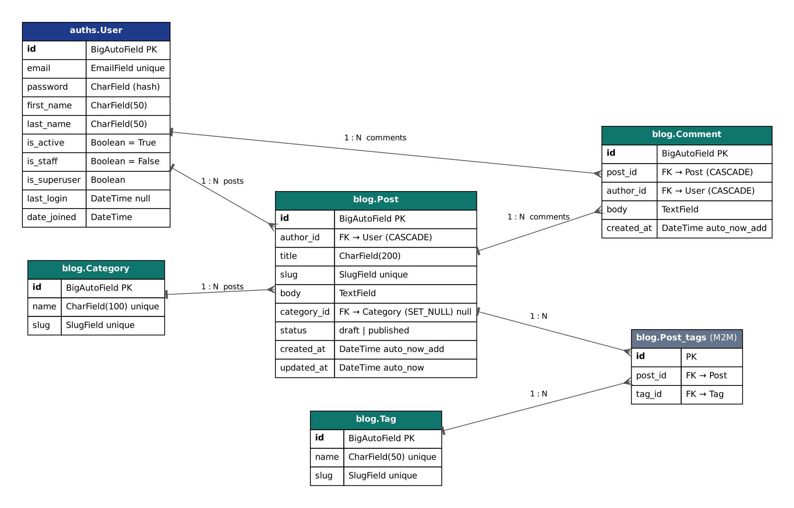

# Blog API

A blog REST API built with Django and Django REST Framework.

## ERD



- **User** — custom user, logs in with `email` (no `username`).
- **Category** — one category has many posts. If a category is deleted, posts stay (`SET_NULL`).
- **Tag** — many-to-many with posts.
- **Post** — has an author, a category, tags and a status (`draft` / `published`).
- **Comment** — belongs to a post and an author.

## Project structure

```
manage.py
requirements/        base.txt, dev.txt, prod.txt
logs/                log files (ignored by git)
docs/                erd.png
apps/
    auths/           custom User model, JWT authentication
    blog/            Category, Tag, Post, Comment
settings/
    .env             secrets (not in git, copy from .env.example)
    conf.py          reads .env with python-decouple
    base.py          shared settings
    urls.py, wsgi.py, asgi.py
    env/
        local.py     DEBUG=True, SQLite
        prod.py      DEBUG=False, PostgreSQL
```

`manage.py` reads `BLOG_ENV_ID` from `settings/.env` and uses `settings.env.local` or `settings.env.prod`.

Load order: `manage.py → settings/env/local.py → settings/base.py → settings/conf.py → settings/.env`.

## Setup

```bash
python -m venv venv
source venv/bin/activate          # Windows: venv\Scripts\activate
pip install -r requirements/dev.txt

cp settings/.env.example settings/.env   # Windows: copy settings\.env.example settings\.env

python manage.py makemigrations auths blog
python manage.py migrate
python manage.py createsuperuser
python manage.py runserver
```

Admin: http://127.0.0.1:8000/admin/

## Environment variables

All variables have the `BLOG_` prefix.

| Variable | Description |
|---|---|
| `BLOG_ENV_ID` | `local` or `prod` |
| `BLOG_SECRET_KEY` | Django secret key |
| `BLOG_POSTGRES_DB`, `BLOG_POSTGRES_USER`, `BLOG_POSTGRES_PASSWORD`, `BLOG_POSTGRES_HOST`, `BLOG_POSTGRES_PORT` | PostgreSQL (prod only) |

## JWT authentication

| Method | URL | Description |
|---|---|---|
| POST | `/api/auth/token/` | Get `access` and `refresh` tokens (`email`, `password`) |
| POST | `/api/auth/token/refresh/` | Get a new `access` token |
| POST | `/api/auth/token/verify/` | Check a token |

Use the token in the header: `Authorization: Bearer <access>`.

## Linter

```bash
ruff check .
```
## Seeding
'python manage.py seed --users 20 --posts 100 --comments 500'
Use '--clear' to delete old data first. Password for all seed users: 'seedpass123'